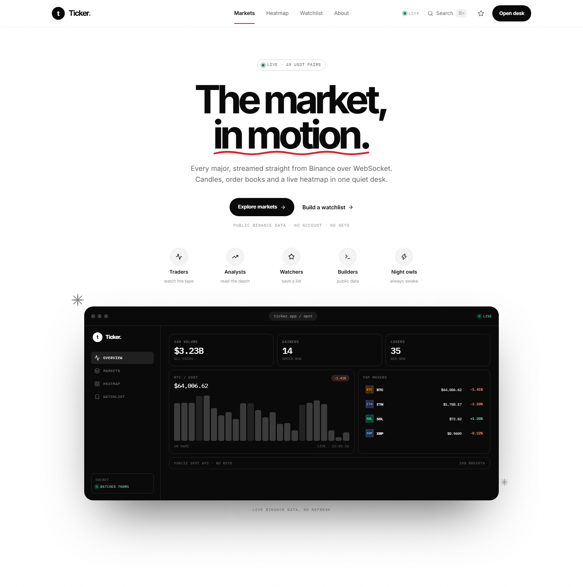
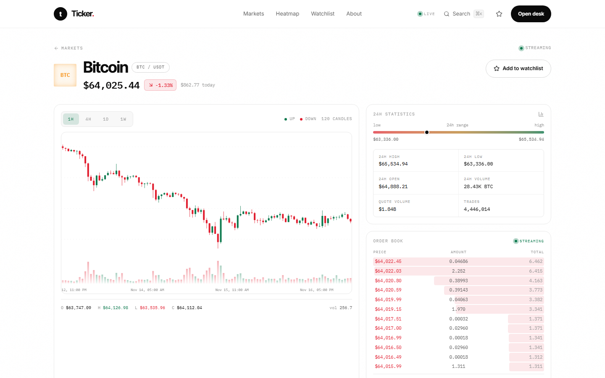
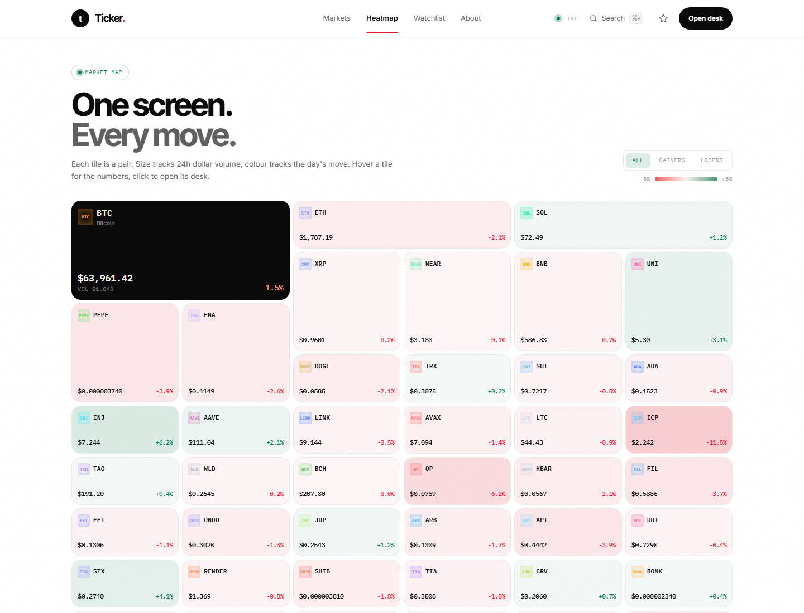

<div align="center">

# Ticker

**The spot desk that moves with the tape.**

Live Binance prices, candles, order book depth, a volume-weighted heatmap and a local watchlist — in one quiet, fast interface. No account. No keys. No refresh button.

[](https://react.dev)
[](https://www.typescriptlang.org)
[](https://vite.dev)
[](https://tailwindcss.com)
[](https://zustand.docs.pmnd.rs)
[](https://binance-docs.github.io/apidocs/spot/en/)



</div>

## Why it exists

Most market dashboards are heavy, gated or full of fake rows. Ticker is the opposite: a small, sharp desk that talks directly to Binance's public spot API, renders everything in real time, and stays out of the way.

- One multiplexed WebSocket for 48 USDT pairs
- Prices batched into the UI every **700ms** — live without thrashing React
- Candles, stats and depth fetched on demand per pair
- Watchlist lives in `localStorage`, so it works without an account
- Keyboard-first: hit `⌘K` or `/` anywhere

## Pages

| Route | What it does |
| --- | --- |
| `/` | Markets: live table, breadth, sparklines, filters and sort |
| `/coin/:symbol` | Desk: candles (1m–1w), volume, depth ladder, 24h stats |
| `/heatmap` | Every pair sized by volume and tinted by its move |
| `/watchlist` | Saved pairs with combined volume and best/weakest |
| `/about` | How the feed works and what the limits are |

## A look inside

<div align="center">





</div>

## Stack

| Layer | Choice |
| --- | --- |
| UI | React 19 + TypeScript |
| Build | Vite 8 |
| Styles | Tailwind CSS 4, hand-rolled design tokens |
| State | Zustand (market feed + persisted watchlist) |
| Routing | react-router-dom |
| Icons | lucide-react |
| Charts | Custom SVG / CSS — no chart library |
| Data | Binance public REST + WebSocket |

## Run it

```bash
npm install
npm run dev
```

```bash
npm run build     # type-check + production build
npx oxlint src    # lint
```

Node 20+ recommended.

## How the data flows

1. `store/market.ts` fetches `/api/v3/ticker/24hr`, then opens one combined stream:
   `wss://stream.binance.com:9443/stream?streams=btcusdt@ticker/...`
2. Incoming frames are buffered and flushed every 700ms, so 48 streams become a few renders per second.
3. REST hosts fall back across `api.binance.com` → `api1` → `api2` → `api3`; the socket reconnects after 4s on drop.
4. Sparklines are cached for 5 minutes and fetched in chunks of five to stay friendly to public rate limits.

## Project layout

```text
src/
  components/   Header, ticker tape, charts, depth ladder, palette, reveal
  hooks/        useSparklines
  lib/          Binance client, curated coin metadata, formatters
  pages/        Markets, Coin, Heatmap, Watchlist, About, NotFound
  store/        market feed, persisted watchlist
  index.css     design tokens + motion system
```

## Notes

Public Binance endpoints are rate limited and can be geo-blocked in some regions. Ticker falls back across four hosts and reconnects the socket automatically, but quotes can still lag the exchange book. Everything here is informational — not financial advice.

## License

MIT — see [LICENSE](LICENSE).
